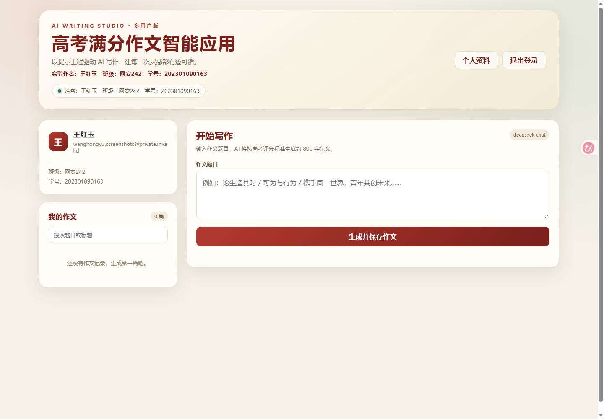
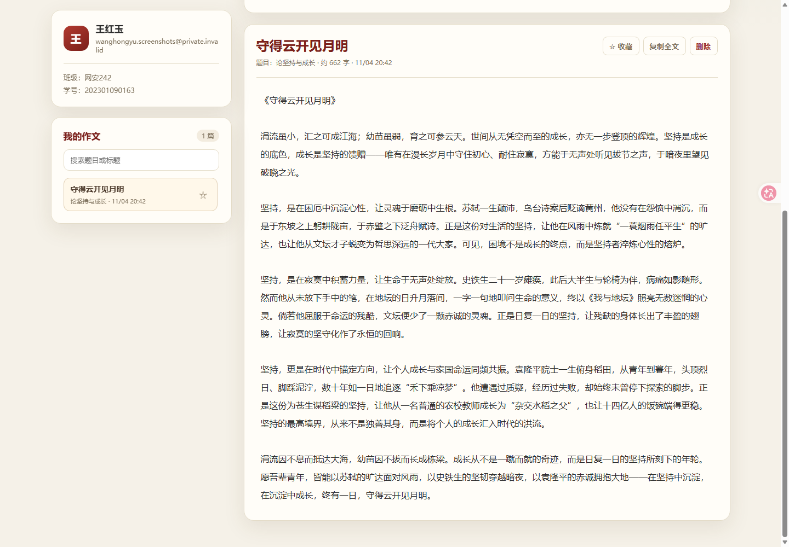

# 高考满分作文智能应用

《生成式人工智能》课程 · 实验1

> 班级：网安242　姓名：王红玉　学号：202301090163

在线体验：<https://gaokao-essay-app.vercel.app>

GitHub 私有仓库：<https://github.com/hongyuw007-cloud/gaokao-essay-app>

## 一、项目简介

本项目是一个基于**提示工程**的多用户智能应用。用户登录后输入高考作文题目，系统调用 DeepSeek 生成约 800 字的满分范文，并将作文自动保存到当前用户的个人历史记录中。

通过分析 20 篇高考满分作文样例，项目归纳出标题、开头、主体、结尾与立意的共性规律，并在系统提示词中综合运用角色设定、评分标准注入、写作规律归纳、思维链和结构化输出约束等提示工程策略。

## 二、功能说明

1. 邮箱注册、登录、刷新登录状态和退出登录；
2. 每位用户独立保存、搜索、查看自己的作文，不同用户的数据相互隔离；
3. 编辑个人资料，并在首页显示姓名、班级和学号；
4. 收藏或取消收藏作文，复制和删除自己的作文；
5. 输入高考作文题目，调用 DeepSeek 生成约 800 字范文；
6. 响应式 Web 界面，可在电脑和手机上使用；
7. 提供 Vercel Serverless 入口和 Supabase 数据库脚本。

## 三、技术栈

- **前端**：原生 HTML + CSS + JavaScript
- **后端**：FastAPI（Python）
- **大模型**：DeepSeek，通过 OpenAI SDK 调用
- **身份认证与数据库**：Supabase Auth + PostgreSQL/PostgREST
- **部署**：Vercel，数据库使用 Supabase

## 四、目录结构

```text
高考满分作文智能应用/
├── api/                  # Vercel Python Serverless 入口
├── backend/
│   ├── main.py           # FastAPI 接口与鉴权
│   ├── prompt.py         # 核心提示词
│   └── supabase_service.py
├── frontend/
│   └── index.html        # 多用户单页应用
├── supabase/
│   └── schema.sql        # 数据表与 RLS 安全策略
├── vercel.json           # Vercel 部署配置
├── pyproject.toml        # Vercel FastAPI 入口与依赖声明
├── requirements.txt
├── .env.example
└── README.md
```

## 五、本地运行

### 1. 安装依赖

建议使用 Python 3.12 或更高版本。

```bash
pip install -r requirements.txt
```

### 2. 创建 Supabase 项目

1. 在 <https://supabase.com> 创建项目；
2. 打开 **SQL Editor**，执行 `supabase/schema.sql`；
3. 打开 **Project Settings → API**，复制 Project URL 和 anon public key；
4. 如需立即体验注册功能，可在 **Authentication → Providers → Email** 中关闭邮箱确认；正式提交时建议保留邮箱确认。

数据库启用了 Row Level Security。用户只能读取、更新和删除 `user_id` 与自身登录 ID 一致的作文。

### 3. 配置环境变量

复制 `.env.example` 为 `.env`：

```dotenv
DEEPSEEK_API_KEY=sk-你的真实Key
DEEPSEEK_BASE_URL=https://api.deepseek.com
DEEPSEEK_MODEL=deepseek-chat
SUPABASE_URL=https://你的项目编号.supabase.co
SUPABASE_ANON_KEY=你的Supabase匿名公开Key
PUBLIC_APP_URL=https://gaokao-essay-app.vercel.app
```

`.env` 已被 `.gitignore` 排除，不能提交真实密钥。

### 4. 启动

在项目根目录执行：

```bash
uvicorn backend.main:app --reload --port 8001
```

浏览器访问 <http://127.0.0.1:8001>，注册账号后即可生成和管理作文。

健康检查地址：<http://127.0.0.1:8001/api/health>

## 六、部署到 Vercel

项目已经包含 `vercel.json` 和 `api/` Serverless 入口。部署前先确认代码已推送到 GitHub。

1. 在 Vercel 中导入 GitHub 仓库；
2. 在 **Settings → Environment Variables** 中添加以下变量：

```text
DEEPSEEK_API_KEY
DEEPSEEK_BASE_URL
DEEPSEEK_MODEL
SUPABASE_URL
SUPABASE_ANON_KEY
```

3. 使用默认构建配置部署，或执行：

```bash
vercel --prod
```

4. 在 Supabase 的 **Authentication → URL Configuration** 中将 Vercel 正式域名填写为 Site URL，并把本地地址和正式地址加入 Redirect URLs；
5. 部署完成后访问 Vercel 域名，注册、登录并生成一篇作文，确认数据写入 Supabase。

前端由 Vercel 从 `frontend/` 目录提供；`/api/auth`、`/api/profile`、`/api/generate`、`/api/essays` 分别由 `api/` 下的 FastAPI Serverless 入口处理。

## 七、接口说明

| 方法 | 路径 | 功能 |
|---|---|---|
| GET | `/api/health` | 检查模型与 Supabase 配置 |
| POST | `/api/auth` | 注册、登录、刷新或退出登录 |
| GET/PUT | `/api/profile` | 获取或更新姓名、班级、学号 |
| POST | `/api/generate` | 生成作文并保存到当前用户 |
| GET | `/api/essays` | 获取当前用户的作文历史 |
| PATCH | `/api/essays` | 收藏或取消收藏 |
| DELETE | `/api/essays?id=...` | 删除当前用户的作文 |

除注册、登录和刷新外，其他用户接口均需要 `Authorization: Bearer <access_token>`。

## 八、运行效果截图

登录/注册页面：


登录后的首页，显示姓名、班级、学号和创作入口：



输入“论坚持与成长”后由 DeepSeek 生成并自动保存的作文结果：



个人作文历史、搜索与收藏管理：


## 九、核心提示词

核心提示词见 `backend/prompt.py`，要点如下：

- **角色设定**：设定为深耕高考语文教学三十年的特级教师、阅卷组组长；
- **评分标准注入**：将内容、结构、语言、字数四维评分标准写入提示词；
- **规律归纳**：从样例归纳标题、开头、主体、结尾和立意的写作规律；
- **思维链**：要求模型先审题立意、谋篇布局，再输出正文；
- **结构化输出约束**：限定“标题→开头→主体→结尾”格式和约 800 字篇幅。

## 十、安全与数据隔离

- DeepSeek 和 Supabase 密钥只保存在服务端环境变量中；
- 后端验证 Supabase access token 后才允许调用用户接口；
- 数据库开启 RLS，用户只能访问自己的作文记录；
- `.env`、`__pycache__` 等本地文件已加入 `.gitignore`。

## 十一、提交材料

本项目代码保存在公共 GitHub 仓库中；在线应用无需 GitHub 账号即可访问。
